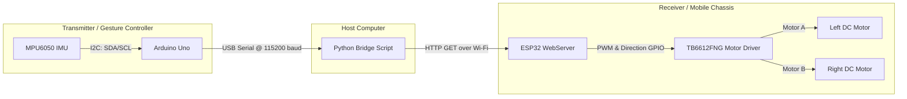

# Gesture-Controlled Robot (Arduino + ESP32 + MPU6050)

A real-time wireless gesture-controlled differential-drive robot. Hand tilt movements (pitch and roll) are captured by an **MPU6050 IMU** interfaced with an **Arduino Uno**, forwarded over USB Serial to a **Python HTTP bridge**, and transmitted over **Wi-Fi** to an **ESP32** driving two DC motors via a **TB6612FNG** dual motor driver with proportional PWM speed control.

---

## System Architecture & Block Diagram



---

## How It Works

1. **Gesture Sensing (`transmitter_arduino`)**:
   - The Arduino Uno reads raw 3-axis accelerometer data (`ax`, `ay`, `az`) from the MPU6050 over I2C every `100 ms`.
   - Raw values are normalized by `16384.0` (±2g sensitivity) to compute **pitch** and **roll**.
   - A deadzone filter (`±0.2g`) prevents unintended drift when the hand is held level.
   - Depending on the dominant tilt axis, the Arduino maps the tilt angle proportionally to a PWM duty cycle (`0–255`) and emits formatted ASCII packets (`F<spd>`, `B<spd>`, `L<spd>`, `R<spd>`, or `S`) over UART.

2. **Serial-to-Wi-Fi Bridge (`bridge_python`)**:
   - A lightweight Python script reads incoming serial packets from the Arduino and sends asynchronous HTTP `GET` requests (`http://<ESP32_IP>/cmd?val=<CMD>`) to the ESP32 over the local Wi-Fi network.

3. **Motor Actuation (`receiver_esp32`)**:
   - The ESP32 hosts an HTTP web server on port `80` listening at the `/cmd` endpoint.
   - Upon receiving a command, it parses the direction character and PWM speed value, driving the **TB6612FNG** H-bridge pins using `5 kHz`, 8-bit LEDC PWM signals for smooth differential steering and active short-brake stopping (`S`).

---

## Hardware Components

| Component | Role |
| :--- | :--- |
| **Arduino Uno** | Reads MPU6050 sensor data over I2C and transmits encoded tilt commands |
| **MPU6050 (6-Axis IMU)** | Measures hand pitch and roll acceleration |
| **ESP32 DevKit** | Hosts HTTP server over Wi-Fi and generates 5 kHz PWM signals |
| **TB6612FNG Motor Driver** | Dual H-bridge driver controlling motor direction and speed |
| **2x DC Gear Motors + Chassis** | Differential-drive robotic base |

---

## Pinout & Wiring

### 1. Transmitter (Arduino Uno + MPU6050)
| MPU6050 Pin | Arduino Uno Pin |
| :--- | :--- |
| `VCC` | `5V` (or `3.3V`) |
| `GND` | `GND` |
| `SDA` | `A4` |
| `SCL` | `A5` |

### 2. Receiver (ESP32 + TB6612FNG)
| TB6612FNG Pin | ESP32 GPIO | Function |
| :--- | :--- | :--- |
| `PWMA` | `GPIO 25` | Motor A Speed (PWM) |
| `AIN1` | `GPIO 26` | Motor A Direction 1 |
| `AIN2` | `GPIO 27` | Motor A Direction 2 |
| `PWMB` | `GPIO 14` | Motor B Speed (PWM) |
| `BIN1` | `GPIO 32` | Motor B Direction 1 |
| `BIN2` | `GPIO 33` | Motor B Direction 2 |
| `STBY` | `GPIO 4` | Standby Control (Active HIGH) |
| `VCC` | `3.3V` | Logic Power |
| `VM` | External Battery (`6V–12V`) | Motor Power |
| `GND` | `GND` (Common Ground) | Ground |

---

## Command Protocol

Commands follow the format `<DIRECTION><SPEED>`, where `<SPEED>` is an 8-bit integer (`0` to `255`):

| Command | Example | Action | Motor A (Left) | Motor B (Right) |
| :--- | :--- | :--- | :--- | :--- |
| `F<spd>` | `F180` | Move Forward | Forward | Forward |
| `B<spd>` | `B150` | Move Backward | Reverse | Reverse |
| `L<spd>` | `L200` | Turn Left | Reverse | Forward |
| `R<spd>` | `R200` | Turn Right | Forward | Reverse |
| `S` | `S` | Brake / Stop | Short Brake | Short Brake |

---

## Setup & Execution

### Step 1: Flash the Arduino Uno
1. Install the **MPU6050** library (by Electronic Cats / Jeff Rowberg) via the Arduino Library Manager.
2. Open `transmitter_arduino/transmitter_arduino.ino`, select your Arduino board and port, and upload.

### Step 2: Flash the ESP32
1. Open `receiver_esp32/receiver_esp32.ino`.
2. Update `ssid` and `password` with your Wi-Fi network credentials.
3. Upload the sketch to the ESP32 (requires ESP32 Arduino Core v3.x for `ledcAttach`).
4. Open the Serial Monitor at `115200` baud and note down the printed **`ESP32 IP`** address.

### Step 3: Run the Python Bridge
1. Navigate to the `bridge_python` folder and install dependencies:
   ```bash
   pip install -r requirements.txt
   ```
2. Edit `serial_wifi_bridge.py` to set your `ARDUINO_PORT` (e.g., `COM6` on Windows or `/dev/ttyACM0` on Linux) and `ESP32_IP`.
3. Run the bridge:
   ```bash
   python serial_wifi_bridge.py
   ```
4. Tilt the MPU6050 to drive the robot!